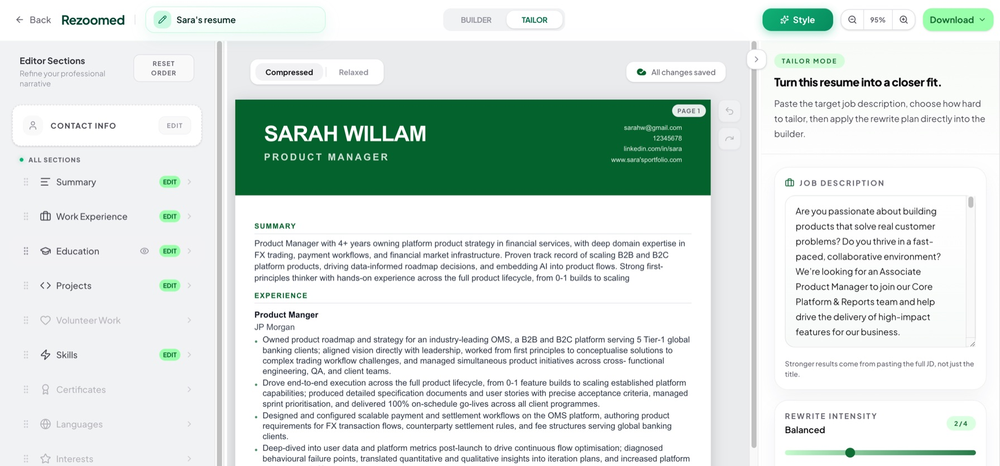

<div align="center">

# Rezoomed

### Build a stronger resume. Tailor it to the role. Keep your applications moving.

An AI-assisted resume and career toolkit built with Next.js, React, TypeScript, and Supabase.

**[Explore the product](https://www.rezoomed.com) · [Get started](#getting-started) · [Project structure](#project-structure) · [Contribute](#contributing)**

</div>



> **About the name:** This repository is named `resumeplanet`; the application and its companion browser extension are branded **Rezoomed**.

## What you can do

Rezoomed brings resume editing, job-specific feedback, and application tools into one workspace.

| Tool | What it does |
| --- | --- |
| **Resume builder** | Create or import a resume, choose a template, reorder sections, adjust styling, and preview the document as you edit. |
| **ATS checker** | Analyze resume content and receive scores, structured feedback, and suggestions for improvement. |
| **Job matching and tailoring** | Compare a resume with a job description and generate targeted rewrite suggestions. |
| **Document export** | Export resumes to PDF and DOCX, with access controlled by the application's plan rules. |
| **Cover letters** | Generate a cover letter using resume content and a target role. |
| **PDF metadata tools** | Inspect and update document metadata through a dedicated dashboard workflow. |
| **LinkedIn tools** | Review and improve profile content through the web app and companion Chrome extension. |
| **Application tracking** | Organize tracked jobs and manual application entries. |
| **Resume websites** | Build a shareable resume site with the Resume Lio editor. |

The repository also includes authentication, subscription billing integrations, an affiliate dashboard, administrative tools, and a blog. Feature availability depends on the configured services and subscription plan. Scores and AI suggestions are guidance, not guarantees of hiring outcomes.

## Technology

| Layer | Implementation |
| --- | --- |
| Application | Next.js 16 App Router, React 19, TypeScript |
| Interface | Tailwind CSS 4, Radix UI, Lucide icons, Framer Motion |
| Editing | dnd-kit, React Hook Form, Zod |
| Data and authentication | Supabase Postgres, Auth, and Storage |
| AI | Shared server-side gateway for Microsoft Foundry and OpenRouter |
| Documents | PDF.js, pdf-lib, jsPDF, Mammoth, docx, Puppeteer/Chromium |
| Integrations | PayPal, Razorpay, Polar, Paddle, Resend, PostHog |
| Browser extension | WXT, Manifest V3, React, TypeScript, Vitest |

## Getting started

### 1. Install the application

Use Node.js **20.9 or newer**, npm, and Git. You will also need a Supabase project; AI-powered features require a configured AI provider.

```bash
git clone https://github.com/Theja4/resumeplanet.git
cd resumeplanet
npm ci
cp .env.local.example .env.local
```

### 2. Configure your environment

Set these values in `.env.local` using your own project credentials:

```dotenv
NEXT_PUBLIC_SUPABASE_URL=https://your-project.supabase.co
NEXT_PUBLIC_SUPABASE_ANON_KEY=your-public-anon-key
SUPABASE_SERVICE_ROLE_KEY=your-server-only-service-role-key
NEXT_PUBLIC_APP_URL=http://localhost:3000
NEXT_PUBLIC_SITE_URL=http://localhost:3000
```

For AI features, configure either:

- **Microsoft Foundry:** `AZURE_AI_FOUNDRY_ENDPOINT`, `AZURE_AI_FOUNDRY_API_KEY`, and `AZURE_AI_FOUNDRY_MODELS` for deployments available in your account.
- **OpenRouter:** `OPENROUTER_API_KEY`, with optional `ANTHROPIC_MODEL` and `ANTHROPIC_MODEL_PREMIUM` model overrides. These variable names are retained by the shared gateway.

When both providers are configured, the gateway defaults to Foundry first, then OpenRouter. See [`lib/claude.ts`](lib/claude.ts) for provider selection and fallback behavior.

The full configuration reference is [`.env.local.example`](.env.local.example). Replace example endpoints and placeholder secrets before use. Keep server credentials out of `NEXT_PUBLIC_*` variables and never commit `.env.local`.

### 3. Prepare the database and authentication

Apply the SQL files in [`supabase/migrations`](supabase/migrations) in filename order to your development project. Review the migrations first: the directory contains both schema changes and seed content, and later features need more than the initial migration.

For Google sign-in, configure the Google provider in Supabase Auth and allow this application redirect:

```text
http://localhost:3000/auth/callback
```

The Google OAuth client's redirect points to your Supabase project's `/auth/v1/callback` endpoint. See [`SETUP.md`](SETUP.md) for the detailed walkthrough. Its original migration and Paddle examples predate newer features; use the current migrations, environment template, and provider implementation when configuring those features.

### 4. Start developing

```bash
npm run dev
```

Open **http://localhost:3000**, sign in, and visit `/dashboard`.

For a first smoke check, create a resume, edit a section, reload to check persistence, and try an export. Check AI analysis separately after configuring a provider.

## Commands

Run these from the repository root:

| Command | Purpose |
| --- | --- |
| `npm run dev` | Start the development server. |
| `npm run build` | Create a production build. |
| `npm start` | Serve an existing production build. |
| `npm run lint` | Run ESLint. |

The root package does not currently define an `npm test` script. The browser extension has its own test suite.

## Optional integrations

- **Payments:** Select the intended provider with `NEXT_PUBLIC_PAYMENT_PROVIDER` and configure its credentials, product or plan IDs, and webhook secrets. The template contains production-oriented defaults; use your provider's sandbox/test configuration for local checkout testing.
- **Email:** Configure `RESEND_API_KEY` and the sender settings for email delivery.
- **Analytics:** Configure the PostHog variables if you want analytics in your environment.
- **Job ingestion:** Configure the job-source settings and protect synchronization with the appropriate `CRON_SECRET` or `JOBS_SYNC_SECRET`. [`vercel.json`](vercel.json) defines the scheduled `/api/jobs/sync` request.
- **Browser-based PDF rendering:** Install Chrome/Chromium locally if needed, or set `CHROME_EXECUTABLE_PATH`. The Resume Lio PDF route also supports the bundled serverless Chromium package.
- **Admin and extension authentication:** Replace `ADMIN_SESSION_SECRET` and `EXTENSION_JWT_SECRET` with independently generated secrets before enabling these flows.

Check the corresponding files in `lib/` and `app/api/` for provider-specific settings; not every integration is required for basic resume editing.

## Chrome extension

The companion LinkedIn profile optimizer is a separate package:

```bash
cd linkedin-profile-optimizer-extension
npm ci
npm run dev
```

To validate and build it:

```bash
npm run compile
npm test
npm run build
```

Load `.output/chrome-mv3` as an unpacked extension in Chrome's developer mode. To include localhost access in a production build for local integration testing, run `INCLUDE_LOCALHOST=1 npm run build`.

The current extension integrates with the Rezoomed backend. Its permissions and allowed hosts are defined in [`wxt.config.ts`](linkedin-profile-optimizer-extension/wxt.config.ts); consult that file when reviewing permissions, since the extension's original README describes an earlier local-only version.

## Project structure

```text
app/                                   Pages, dashboard, auth, and API routes
components/                            Shared UI, landing page, and editor components
hooks/                                 Shared React hooks
lib/                                   AI gateway, parsers, exports, billing, and data access
supabase/migrations/                   Database schema, policies, and seed migrations
public/                                Images, fonts, and template assets
linkedin-profile-optimizer-extension/  Independent WXT browser extension
scripts/                               Maintenance and content utilities
docs/                                  Design notes and implementation plans
SETUP.md                               Extended setup walkthrough
```

The web app uses Supabase for identity and persistence. Server routes coordinate AI requests, document processing, and external integrations. The extension is built independently and connects to the web application's extension endpoints.

## Contributing

Open an issue describing the bug or proposed improvement, then keep changes focused in a pull request. Include reproduction steps, screenshots for interface changes, and the checks you ran. Use sample resume data in fixtures and screenshots.

Before submitting application changes, run `npm run lint` and `npm run build` with the required environment configured. For extension changes, also run its compile and test commands.

## License

No license has been specified in this repository. Public visibility alone does not grant an open-source license; obtain permission from the owner before redistributing or reusing the code beyond rights provided by GitHub's terms.
